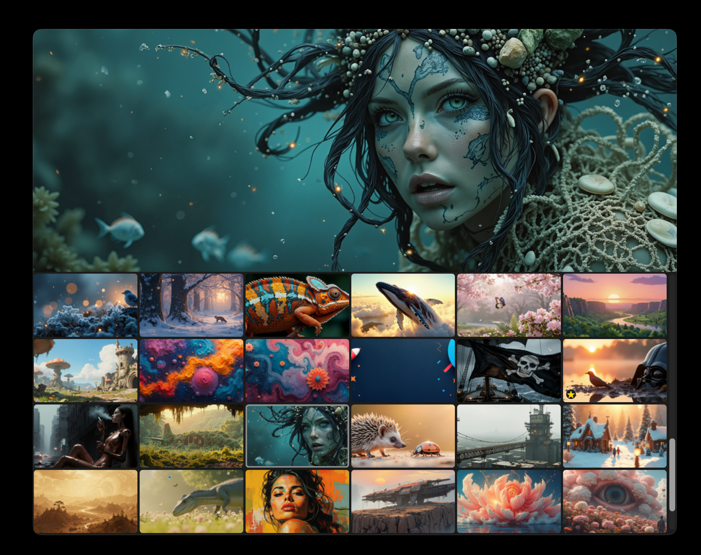

  

  <strong>Free wallpaper library manager for macOS.</strong> 
  Per-display wallpapers. Slideshow. Native AppKit.

Mural is a local-first wallpaper library: point it at a folder, browse and preview your
images, keep favorites, and organize a slideshow for each display. It never modifies,
moves or deletes your files.

<h2>Features</h2>

<ul>
  <li>Independent wallpaper per display</li>
  <li>No overwriting — your images are never modified, moved or deleted</li>
  <li>Library with search, sort, preview and folder favorites</li>
  <li>Slideshow mode with per-display image selections</li>
  <li>Optional AVIF reading and conversion</li>
  <li>Native AppKit interface, no Electron</li>
</ul>

<h2>Formats</h2>

PNG, JPEG, BMP and WebP. AVIF is read natively when macOS ImageIO provides the decoder.
The optional AVIF conversion writes a lossy copy to the app cache and never modifies the original.

  

https://github.com/user-attachments/assets/3da52a0b-04a9-4d56-9e5b-abd66f01ace4

<h2>Install</h2>

<strong>Homebrew</strong>

<pre><code>brew install --cask gaorfg-bit/mural/mural-macos</code></pre>

<em>Apple silicon; macOS 13 is the declared minimum, with compatibility on older
macOS versions still being tested. Version 0.1.1 is a beta and is not notarized.
If macOS blocks its first launch, read
<a href="https://support.apple.com/102445">Apple’s instructions</a> before deciding
whether to allow it in System Settings → Privacy &amp; Security → Open Anyway.
Read the <a href="https://github.com/gaorfg-bit/homebrew-mural/releases/tag/v0.1.1">release notes and installation instructions</a> before trying the beta.</em>

<strong>Build from source</strong>

<strong>Step 1 — Install dependencies</strong>

<pre><code>xcode-select --install
curl --proto '=https' --tlsv1.2 -sSf https://sh.rustup.rs | sh</code></pre>

<strong>Step 2 — Download and build</strong>

<pre><code>git clone https://github.com/gaorfg-bit/Mural-macOS
cd Mural-macOS
make sparkle
make bundle OFFLINE= SIGN=-
open Mural.app</code></pre>

Rust 1.88 or later is required. Tests are verified with Rust 1.88.0 and 1.98.1.

<em><code>OFFLINE=</code> lets Cargo fetch its dependencies on a fresh machine;
<code>SIGN=-</code> uses an ad-hoc signature when no local signing identity is installed.</em>

<strong>Uninstall:</strong>

<pre><code>brew uninstall --cask mural-macos
rm -rf Mural.app   # source build only</code></pre>

macOS 13 or later. The signed 0.1.0 build is Apple silicon only.

Your images, settings, caches and logs stay on your Mac — see <a href="PRIVACY.md">PRIVACY.md</a>.

GPL-3.0 — © 2026 GaoR

## Updates

Starting with 0.1.1, Mural checks for updates daily using Sparkle and offers to install them.
Use **Mural → Check for Updates…** for a manual check. Update archives are signed.
The existing 0.1.0 needs one manual upgrade to gain the built-in updater.

For a source build, run `make sparkle` once to download and verify Sparkle 2.10.0,
then `make bundle`. Cargo builds and subsequent bundle builds remain offline.
See [update distribution](docs/MISES-A-JOUR.md) for release preparation.
